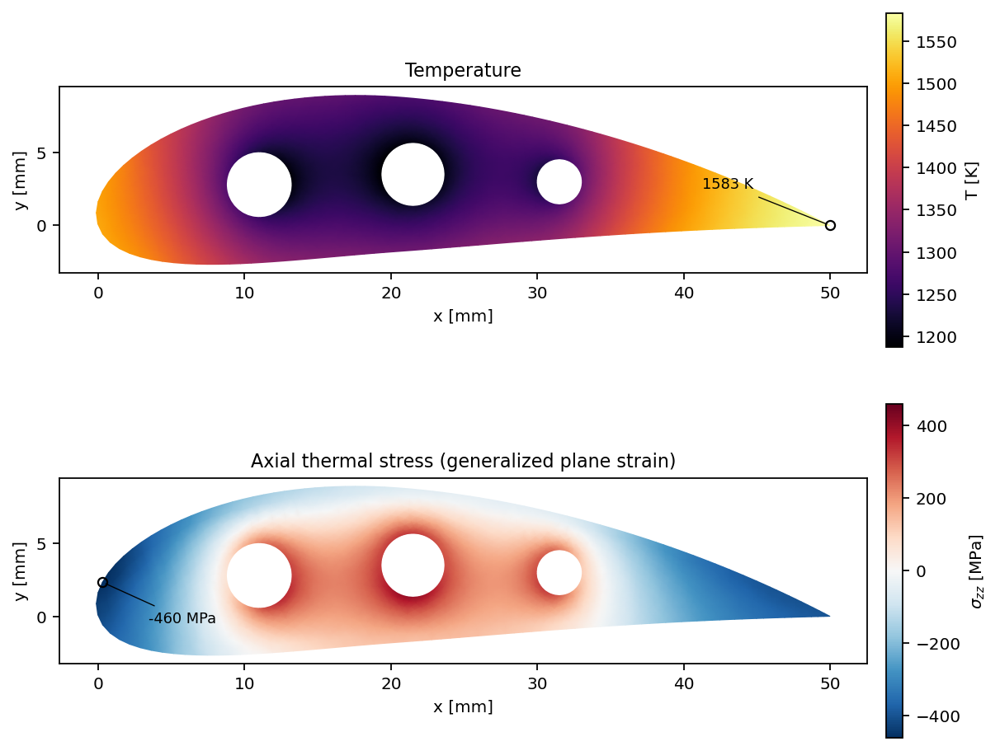
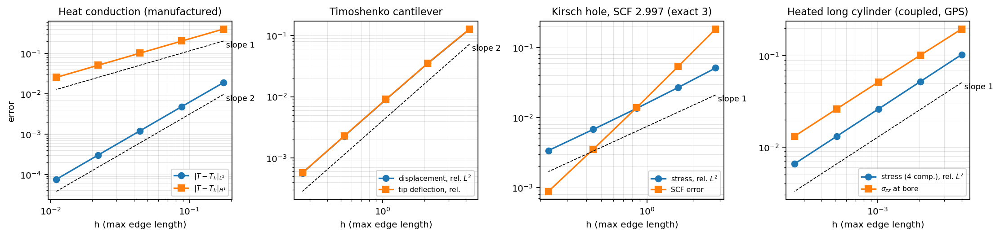
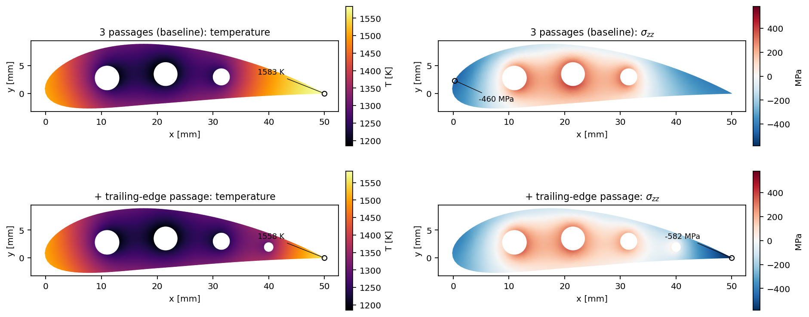

# blade-fem

[](https://github.com/l4NGEL/blade-fem/actions/workflows/ci.yml)

A small finite element code in C++17 for the steady temperature and thermal stress in a
cooled turbine-blade cross-section. Hot gas heats the outer surface, cooling air flows
through internal passages, and the resulting temperature field loads a structural model
of the section.



The solver is written from scratch on top of Eigen's sparse matrices: element routines,
assembly, boundary conditions, a Gmsh mesh reader and HDF5/XDMF output. Every part is
checked against closed-form solutions, and the observed convergence orders match theory.

## What it solves

| Physics | Formulation |
|---|---|
| Steady conduction | −∇·(k∇T) = Q with fixed temperature, heat flux and convection (h, T∞) boundaries |
| Linear elasticity | Constant-strain triangles (CST) in plane stress, plane strain or generalized plane strain |
| Thermal stress | The nodal temperature from the conduction solve becomes a thermal-strain load |
| 1D reference | Linear-element bar with the same boundary-condition types, used to bootstrap the test suite |

**Why generalized plane strain.** A blade is long compared with its section. Most of its
thermal stress is *axial* (σzz): the hot surface wants to grow longer than the cool core.
Plane stress sets σzz = 0 and misses this entirely. Plane strain forbids any axial growth
and predicts roughly −2.5 GPa (−Eα·ΔT_mean) from the mean temperature rise alone. Generalized plane strain
lets the section stretch and bend freely, with εzz = e₀ + κₓx + κᵧy. The three extra
unknowns are solved together with the displacements, so the net axial force and both
bending moments vanish, as they do at the free ends of a blade. See
[docs/theory.md](docs/theory.md) for the formulation.

## Verification

`bladefem-verify` refines the mesh on four problems with known solutions and reports the
observed order of convergence (h = longest element edge):



| Problem | Quantity | Observed order | Expected |
|---|---|---|---|
| Conduction, manufactured T = sin πx sin πy | L² error / H¹ error | 2.00 / 1.00 | 2 / 1 |
| Timoshenko cantilever (Augarde & Deeks 2008 form) | displacement, relative L² | 2.00 | 2 |
| Kirsch plate with a hole, exact far-field tractions | stress, relative L² | 1.03 | 1 |
| Kirsch plate | stress concentration factor | 2.997 at the finest mesh | 3 |
| Long cylinder, heated bore, convective outer wall (coupled conduction + GPS) | all four stresses, relative L² | 1.00 | 1 |

The last row exercises the whole blade pipeline (conduction, then temperature-driven
generalized plane strain) against Timoshenko & Goodier's free-ended cylinder solution.

The Catch2 suite (30 scenarios, written `SCENARIO / GIVEN / WHEN / THEN`) adds checks that
must hold exactly, not just converge:

- patch tests on distorted meshes;
- uniaxial tension, and free and fully clamped thermal expansion;
- heat balance across all boundaries to round-off;
- self-equilibrated thermal loads that leave statically determinate supports unloaded;
- error handling for ill-posed problems and malformed inputs.

## Blade case

The geometry ([scripts/make_blade_geo.py](scripts/make_blade_geo.py)) is a 50 mm chord,
NACA-type section with heavy camber and 22 % thickness. It has three cooling passages on
the camber line. Gmsh meshes it with linear triangles. Boundary conditions
([cases/blade.json](cases/blade.json)):

| Boundary | h [W/m²K] | T∞ [K] |
|---|---|---|
| Leading edge (stagnation region, x/c < 0.06) | 3000 | 1600 |
| Pressure side | 1800 | 1600 |
| Suction side | 1200 | 1600 |
| Cooling passages | 2000 | 800 |

Material: k = 22 W/mK, E = 160 GPa, ν = 0.30, α = 15·10⁻⁶ 1/K, which is the order of
magnitude for a nickel superalloy at operating temperature. Rigid-body motion is removed
by a pin and a roller on the camber line. The thermal load is self-equilibrated, so their
reactions come out at ~10⁻⁶ N/m.

**These inputs are illustrative.** The film coefficients are assumed rather than computed
from the flow, and the section is not a real engine blade. The point is a credible,
verified workflow, not a design number.

### Results and mesh independence

| Mesh size [mm] | Nodes | T min / max [K] | σzz min / max [MPa] | von Mises max [MPa] |
|---:|---:|---:|---:|---:|
| 1.6 | 522 | 1188.5 / 1583.5 | −448 / 417 | 446 |
| 0.8 | 1681 | 1187.4 / 1583.3 | −465 / 424 | 462 |
| 0.4 | 6205 | 1187.1 / 1583.3 | −469 / 423 | 468 |
| 0.2 | 23460 | 1187.0 / 1583.2 | −471 / 418 | 470 |

Temperatures are mesh-independent to 0.1 K, and the peak stresses settle within about 1 %
between the two finest meshes. The default 0.8 mm mesh solves in about 0.05 s. The global
heat balance closes to 10⁻⁹ W/m.

The stress pattern is the expected one:

- The hot outer wall, especially at the leading edge, is in axial compression.
- The cool walls around the passages are in tension.
- The mean axial strain e₀ = 1.56·10⁻² corresponds to α times the mean temperature rise.

### A design observation: the trailing edge

The hottest point is the thin trailing edge at 1583 K, only 17 K below the gas
temperature, because internal passages cannot reach it. Adding a fourth, small passage at
80 % chord ([cases/blade_te_passage.json](cases/blade_te_passage.json)) cools the body but
barely helps the trailing edge:

| | T max [K] | σzz min [MPa] | von Mises max [MPa] |
|---|---:|---:|---:|
| 3 passages | 1583 | −465 | 462 |
| + trailing-edge passage | 1558 | −582 | 580 |

The peak stress *rises* by a quarter and moves to the trailing edge. A cooler body makes
the still-hot edge stand out more against it, so the edge is compressed harder. This is
the reason real blades cool the trailing edge with ejection slots rather than with more
internal passages.



## Limitations

- **Element order.** Linear triangles give first-order stresses. Boundary peaks read
  through nodal averaging converge from below (see the mesh table).
- **Material data.** Properties are temperature-independent and the material is linear
  elastic: no plasticity or creep, and no single-crystal anisotropy.
- **Loads.** Thermal load only. Centrifugal and gas-bending loads, which dominate real
  blade stresses together with thermal ones, are not included.
- **Boundary data.** Film coefficients are uniform per boundary and prescribed rather than
  coupled to a flow solution.
- **Linear solver.** A direct sparse solver (Eigen `SimplicialLDLT`) is used. That is ample
  for 2D sections; large 3D models would need an iterative or supernodal solver.

## Building and running

Dependencies: a C++17 compiler, CMake ≥ 3.20, Eigen 3, Boost (`program_options`;
`property_tree` is header-only), HDF5 and Catch2 3. Catch2 is fetched automatically if it
is not installed. Gmsh and Python (numpy, matplotlib, h5py) are needed for the blade
meshes and the figures. On Ubuntu 24.04 the [Dockerfile](Dockerfile) lists the packages.

```bash
cmake -S . -B build -G Ninja -DCMAKE_BUILD_TYPE=Release
cmake --build build
ctest --test-dir build --output-on-failure

python3 scripts/make_blade_geo.py
gmsh meshes/blade.geo -2 -format msh22 -o meshes/blade.msh
./build/blade-fem cases/blade.json            # writes results/blade/blade.{h5,xdmf}
./build/bladefem-verify                       # convergence tables + CSV
```

Open `results/blade/blade.xdmf` in ParaView to browse every field: temperature,
displacement, all stress components and von Mises (per element and node-averaged).

`scripts/reproduce.sh` regenerates every number and figure in this README. It can run
inside the container:

```bash
docker build -t blade-fem:dev .
docker run --rm -v "$PWD:/src" blade-fem:dev scripts/reproduce.sh
```

CI (GitHub Actions, Ubuntu 24.04) builds with warnings as errors in two configurations,
Release and Debug with AddressSanitizer + UndefinedBehaviorSanitizer. It runs the test
suite, the verification studies and the blade mesh study, and uploads the results.

## Layout

```
include/bladefem/   public headers: mesh, thermal2d, elastic2d, verification, hdf5_io, case_*
src/                implementation (one file per header) + internal quadrature rules
apps/               blade-fem (case runner), bladefem-verify (convergence studies)
tests/              Catch2 scenarios
cases/              JSON case files
scripts/            geometry generator, mesh study, figures, reproduce.sh
docs/               theory notes and figures
```

## References

- S. Timoshenko, J. N. Goodier, *Theory of Elasticity*, 3rd ed., McGraw-Hill, 1970.
  Source of the cantilever, the plate with a hole, and the thermal stresses in a thin disk
  and in a long cylinder with free ends.
- C. E. Augarde, A. J. Deeks, "The use of Timoshenko's exact solution for a cantilever
  beam in adaptive analysis", *Finite Elements in Analysis and Design* 44 (2008) 595–601.
- D. A. Dunavant, "High degree efficient symmetrical Gaussian quadrature rules for the
  triangle", *Int. J. Numer. Meth. Eng.* 21 (1985) 1129–1148.
- T. J. R. Hughes, *The Finite Element Method*, Dover, 2000.

## License

MIT, see [LICENSE](LICENSE).
